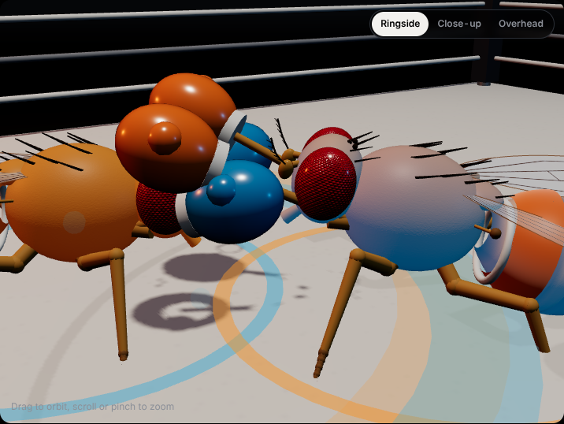
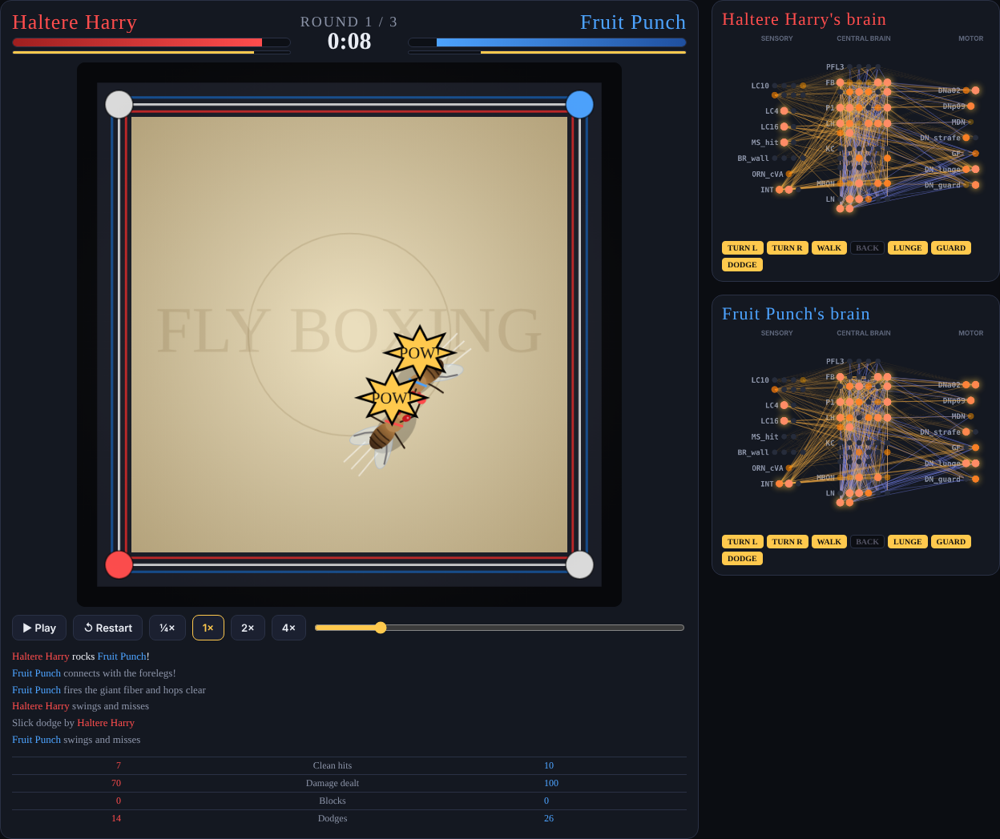

# 🥊 Fly Boxing

Fruit flies with brains wired after the *Drosophila* connectome, trained by evolution to box each other in a 28 mm ring, with every fight shown next to the real fly brain lighting up.

**[▶ Watch the fights at fly-boxing.vercel.app](https://fly-boxing.vercel.app)**



Every move a fighter makes, from turning to face its rival to lunging, guarding and escape-hopping, comes out of simulated neurons. Nobody programmed a punch: the flies found them.

## What's on the site



- **Live fights:** pick any two fighters from a roster of 10 (the champion, the top contenders, champions from earlier generations, untrained newborns and a scripted sparring bot), or hit Random matchup. Your browser runs their brains and simulates a brand-new fight on the spot. Fighters start from a different spot each round and their neurons carry a little random noise, like real neurons, so rematches play out differently; a running head-to-head record shows how a matchup tends to go.
- **The fight card:** five recorded bouts, including a title fight that ends in a knockout upset.
- **A 3D ring:** detailed fly models with faceted compound eyes, a segmented abdomen, veined wings, jointed legs, boxing gloves and trunks. Drag to orbit, or switch between ringside, close-up (follows the action) and overhead cameras.
- **The real brain:** next to each fighter, all 139,248 neurons of the FlyWire fly brain at their true positions. The real neurons of every cell type the model uses glow in the fighter's colour as their model counterparts fire.
- **Neuron grid:** every one of the model's 94 neurons, grouped by what it does (senses, brain, motor), live.

## How it works

```
 eyes / nose / touch             central brain                  descending neurons        body
 ───────────────────             ─────────────                  ──────────────────        ────
 LC10  rival position  ──┐     PFL3  steering        ──┐       DNa02   turn L/R      ──▶  walk, turn
 LC4   looming rival   ──┼──▶  FB    fan-shaped body ──┼──▶    DNp09   walk forward  ──▶  back up, side-step
 LC16  sudden lunge    ──┤     P1    aggression      ──┤       MDN     back up       ──▶  LUNGE (punch)
 JO    got hit L/R     ──┤     LH    lateral horn    ──┤       GF      giant fiber   ──▶  DODGE (escape hop)
 BR    touching ropes  ──┤     KC/MBON mushroom body ──┤       DN_lunge / DN_guard   ──▶  GUARD (forelegs up)
 Or67d rival's scent   ──┘     LN    inhibition      ──┘
```

1. **Wiring** (`flybox/connectome.py`): 94 neurons in 21 real fruit-fly cell types, joined by ~840 synapses. Which cell types connect follows known fly circuits (LC4 → giant fiber, P1 → aggression, PFL3 → DNa02 steering...). Every neuron is either excitatory or inhibitory, like real neurons, and flies are born with a left/right map: a rival on the left excites left-side steering cells.
2. **Brain** (`flybox/brain.py`): a firing-rate network stepped 30 times a second. Sensory neurons are driven by what the fly sees, smells and feels; the descending neurons' activity becomes movement.
3. **Ring** (`flybox/arena.py`): top-down physics. A lunge only lands in range and roughly head-on, a guard facing the attacker blocks most of the damage, and a giant-fiber hop dodges entirely. Lunging and dodging cost stamina.
4. **Training** (`flybox/evolve.py`): evolution by self-play. A fly's genome is the strength of every synapse in its wiring diagram. Each generation, flies fight their peers, past champions and the sparring bot. Fitness = damage dealt − 0.8 × damage taken + a knockout bonus. The best breed and mutate. The wiring never changes, only how strongly each existing synapse fires.
5. **Live engine** (`docs/engine.js`): the brain and ring physics ported to JavaScript, so the browser can run the trained brains itself. Live fights add small neural noise and varied starting spots for variety. With those switched off, `tests/test_engine_parity.py` runs the same fight in Python and JavaScript and checks they match frame by frame.
6. **Viewer** (`docs/index.html`): three.js scene, the FlyWire brain point clouds and the live panels, all in one static page.

Real male fruit flies do fight over food and mates: they lunge, flick their wings as a threat, and rear up to strike with their forelegs. This project just gives them gloves.

## Results

After 150 generations of 48 flies:

| | Generation 0 | Generation 150 |
|---|---|---|
| Wins against the sparring bot | 4% | 100% |
| Clean hits per 15-second bout | 0.3 | 2.8 |

Round robin of the roster (every fighter against every other, 4 bouts each, in the browser engine):

| Fighter | Who they are | Win rate |
|---|---|---|
| Wingnut | Champion of generation 50 | 76% |
| Larva Loca | #5 contender, generation 150 | 69% |
| Iron Mel | #3 contender, generation 150 | 68% |
| Haltere Harry | Champion, generation 150 | 60% |
| Kid Lunge | #4 contender, generation 150 | 56% |
| Fruit Punch | #2 contender, generation 150 | 53% |
| The Giant Fiber | Champion of generation 125 | 46% |
| Sparring Bot | Scripted | 19% |
| Proboscis Pete | Best newborn, generation 0 | 10% |
| Six-Leg Sally | Newborn, generation 0 | 1% |

The training "champion" isn't the best all-rounder. That's a known quirk of self-play: flies get good at beating whatever style is common in their own generation, so an ancestor with an out-of-fashion style can beat its descendants.

## What's real and what's modelled

- **Emergent:** every move. No fight behaviour is scripted; it all comes from evolved synapse strengths.
- **Real anatomy:** the 3D brains are the FlyWire map of a real fly brain, every neuron at its measured position, tagged with its real cell type.
- **Hand-built:** the default wiring table (based on published fly circuits), the ring rules (damage, reach, stamina), the sparring bot, fighter names and commentary lines.
- **Why 94 neurons, not 139,248?** The full wiring diagram has around 50 million connections. Simulating two whole brains 30 times a second in a browser isn't realistic, and evolution can't tune 50 million synapse strengths from a few thousand practice fights. Each model neuron stands in for a whole cell type instead.
- **One substitution:** FlyWire's brain is female, and P1 aggression neurons only exist in males, so the brain view lights pC1, their female counterparts.

## Run it yourself

```bash
pip install -r requirements.txt
python train.py                    # 150 generations, about 15 min on a laptop
python train.py --generations 50   # quick run
python -m http.server -d docs      # then open http://localhost:8000
```

`train.py` writes `models/champion.npz`, `models/history.json` and `docs/fights.js` (recorded fights, the fighter roster and the brain layout). The viewer needs to be served over http (as above, or any static host) because it loads JavaScript modules; double-clicking `index.html` won't work.

Run the tests with `pip install pytest && pytest -q tests` (the parity test also needs Node.js).

### Wire it with real FlyWire connectivity

The default wiring follows the literature. To take wiring densities, synapse strengths and excitatory/inhibitory signs from the real connectome instead:

1. Download `connections.csv.gz` and `consolidated_cell_types.csv.gz` from [codex.flywire.ai](https://codex.flywire.ai/api/download) (free account; follow FlyWire's citation terms).
2. Train on it:

```bash
python train.py --flywire-connections connections.csv.gz --flywire-types consolidated_cell_types.csv.gz
```

The loader matches real neurons to the 21 model cell types by name, measures how densely and strongly each pair of types connects in the real brain, and uses FlyWire's transmitter predictions for signs. The model stays at 94 neurons, so think "wired by FlyWire statistics", not "full brain emulation".

### Rebuild the 3D brain data

```bash
python tools/export_brain3d.py Supplemental_file1_neuron_annotations.tsv
```

The table comes from [flyconnectome/flywire_annotations](https://github.com/flyconnectome/flywire_annotations) (`supplemental_files/`). Output: `docs/brain3d.bin` and `docs/brain3d.json`, about 1.1 MB.

## Deploy

**Vercel:** [vercel.com/new](https://vercel.com/new) → import this repo → Deploy. `vercel.json` serves `docs/` with no build step and sets cache headers; every push redeploys. If a push doesn't show up, open Deployments in the Vercel project and redeploy the latest one.

**GitHub Pages:** Settings → Pages → Deploy from a branch → `main` / `docs`.

## Project layout

```
flybox/connectome.py      cell types, pathways, innate wiring, FlyWire loader
flybox/brain.py           batched firing-rate brain, motor readout
flybox/arena.py           the ring: physics, strikes, guards, dodges, replays
flybox/evolve.py          self-play neuroevolution
train.py                  train, export fights + roster
tools/export_brain3d.py   builds the 3D brain data from FlyWire annotations
tests/                    unit tests and the Python/JS parity test
docs/index.html           the viewer (3D ring, brains, live mode)
docs/engine.js            JavaScript port of brain + ring for live fights
docs/fights.js            recorded fights, fighter roster, brain layout
docs/brain3d.*            139,248 FlyWire neuron positions + cell-type tags
docs/vendor/              three.js (MIT)
vercel.json               static hosting config
```

## Ideas for round two

- Tournament bracket mode for the roster.
- Train with real FlyWire connectivity and compare fighting styles.
- More cell types (Tk aggression neurons, octopamine modulation).
- Spiking neurons instead of firing rates.

## Credits

- Brain anatomy and cell types: FlyWire Consortium. Dorkenwald et al., *Neuronal wiring diagram of an adult brain*, Nature 2024; Schlegel et al., *Whole-brain annotation and multi-connectome cell typing of Drosophila*, Nature 2024; plus the papers listed in the [flywire_annotations README](https://github.com/flyconnectome/flywire_annotations#how-to-cite).
- 3D rendering: [three.js](https://threejs.org) (MIT).

## License

MIT
